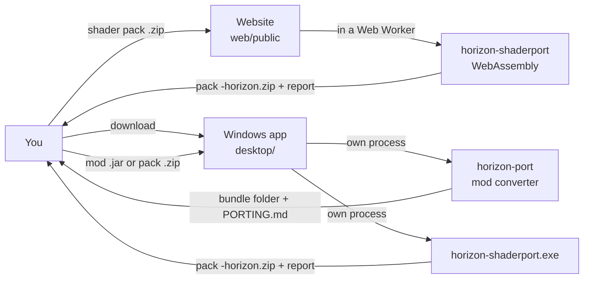
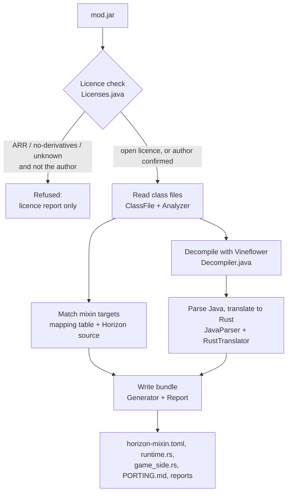
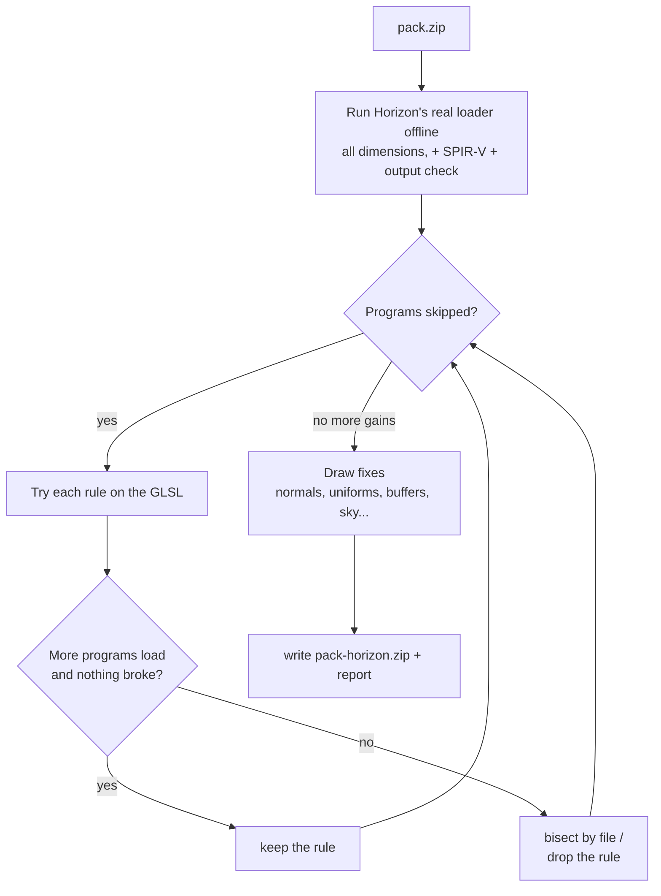

# How Horizon Translator works

A walk through what happens to a file from the moment you pick it. The [README](../README.md) has the
short version; the two converters' own READMEs have every command and rule.

## The whole trip

Nothing is uploaded: shader packs are converted inside the browser, mods inside the Windows app.



## Mod converter (horizon-port)



### 1. Licence check

The jar's `fabric.mod.json` `license` field and any `LICENSE`/`COPYING` file are read and sorted into:

- **open** (MIT, Apache, BSD, ISC, Zlib, GPL, LGPL, AGPL, MPL, EUPL, OSL, CC-BY, CC0, Unlicense, …): allowed, with the
  licence's conditions copied into `PORTING.md`;
- **closed** (All Rights Reserved, "no derivatives", custom terms forbidding decompiling) and **unknown**:
  refused, unless you pass your name with `--i-am-the-author` (in the app: *I made this mod*) and it
  matches an author listed in the jar.

Nothing is decompiled before this passes.

### 2. Reading the jar

`ClassFile.java` is a small class-file parser written for this project. `Analyzer.java` uses it to list:
the mod id, name, version and entry points; every Mixin class with its target classes; each injector
annotation with its target method, `at` point, `cancellable`, ordinal and so on; accessors and invokers;
and every Minecraft and Fabric API method the mod's code calls.

### 3. Decompiling

Vineflower (Apache-2.0) runs as a separate Java process and writes `.java` files to `out/<modid>-src`,
outside the bundle. The source is used for translation only. The app deletes it right after the
conversion and never offers it for download.

### 4. Matching mixins to Horizon

Horizon is Minecraft rewritten, so its functions have different names and shapes. Two sources of truth:

- `mappings/horizon-mappings.json`: a hand-checked table from Minecraft methods (Mojang names) to Horizon
  functions;
- Horizon's source itself (`--horizon-src`): `SourceMatch.java` indexes every function and its doc
  comment. Horizon writes doc comments like `doc is LocalPlayer.aiStep`, so when the doc comment and the
  name (or implementation) agree, the match is "high confidence" and taken automatically.

Each Sponge Mixin injector becomes a horizon-mixins kind:

| Fabric / Sponge Mixin | Horizon |
|---|---|
| `@Inject(at = HEAD)`, cancellable | `HEAD` (with early return) |
| `@Inject(at = RETURN)` | `RETURN` |
| `@Inject(at = INVOKE)` / `@Redirect` | `BEFORE_CALL` / `AFTER_CALL` / `WRAP_OPERATION` |
| `@ModifyArg`, `@ModifyArgs`, `@ModifyVariable`, `@ModifyConstant` | `MODIFY_ARG`, `MODIFY_ARGS`, `MODIFY_VARIABLE`, `MODIFY_CONSTANT` |
| `@WrapOperation` | `WRAP_OPERATION` |
| `@Overwrite` | `OVERWRITE` (written commented out for a person to check) |
| `@Accessor`, `@Invoker` | bridges `GET` / `SET` / `INVOKE` |

Anything without a high-confidence match is written into `horizon-mixin.toml` commented out, with a
TODO note explaining what's missing.

### 5. Translating Java to Rust

`JavaParser.java` parses the decompiled (or original) Java into a syntax tree. `RustTranslator.java`
turns it into Rust, one method at a time, **whole or not at all**: a method that can't fully convert is
left out and the reason is written to `report/translation.md`, so nothing half-works.

What it handles: classes with fields and constructors, static state, records (with equality), enums,
switch statements and expressions, loops and iterators, lambdas, method references, streams and
comparators, `List`/`Map`/`Set`/`Optional` (null becomes `Option`), strings and `StringBuilder`, maths,
`Random`, atomics, JOML vectors/matrices and `PoseStack`, regex (`jregex.rs`), Gson (`jjson.rs`),
`Properties` (`jprops.rs`), files in the mod's config folder, try/catch, Fabric's mod metadata
(`jfabric.rs`), HTTP update checkers (`jhttp.rs`) and futures (`jfuture.rs`).

Game calls are mapped to Horizon helpers: chat messages, key bindings (read from the key hook), tick and
HUD events, hand/item rendering poses, and mod config screens, which become a page in Horizon's
*Options → Mods* with toggles, number buttons and the mod's own labels from its `en_us.json`.

### 6. The bundle

`Generator.java` writes a horizon-mixins bundle. Everything switched on is safe by default: injections
start out behaviour-neutral (empty `HEAD`, pass-through `RETURN`/`WRAP`) and each converted piece adds
the mod's behaviour, so a bundle always builds and plays. `PORTING.md` lists what's on, what's off and
why, and the licence result.

Building a bundle into the game runs native code, so that step is always done by you, with
`horizon-launcher native-build … --trust-native-code`.

## Shader converter (horizon-shaderport)



### 1. Loading it like the game

The tool links Horizon's own `horizon-shaders` crate (that's why it needs Horizon's source to build) and
runs its pack loader without a GPU: OptiFine/Iris preprocessor, `shaders.properties`, per-dimension
folders, then GLSL → naga. `gpu.rs` adds the last step the game does on the GPU: writing SPIR-V and
checking each output against its render target's format. The result: for each dimension, which programs
load and which would be skipped, with the first error.

### 2. Rewriting what fails

The rules (`fix.rs` `RULES`, `gpu_fix.rs`, and one file per bigger rule) are small rewrites that keep
the shader's meaning. Examples:

- `join-macro-calls`: Horizon's preprocessor expands one line at a time, so a macro call split over
  lines is joined (keeping the line count so error lines still match);
- `const-in-params`, `rename-sampler`, `infinite-literal`: things naga's GLSL reader rejects;
- `out-arg-temporary`: a vector component passed to an `out` parameter crashes SPIR-V output, so it goes
  through a temporary;
- `pad-outputs`, `drop-unbuffered-outputs`: outputs that don't fit the pack's buffers;
- `stand-in-3d`: Horizon binds 2D textures where packs expect 3D ones, so 3D lookups get a 2D stand-in;
- `compute-to-fragment`: compute passes (unsupported) redone as fragment passes where possible.

A rule is kept only if **more programs load and no program that loaded before now fails**. If a rule
helps some files but breaks others, the tool bisects by file. Only `images-off` removes a feature
(image load/store), and the report says so.

### 3. Fixing how it draws

Loading isn't everything: some packs loaded but looked wrong. Each pack was captured in Horizon and in
Java Edition + Iris from the same spot and compared, sometimes down to exact pixel values. That found
differences in how Horizon renders, each worked around by a pass that runs on every pack:

| Pass | Why |
|---|---|
| `face-normals` | terrain arrives with every normal pointing up; rebuilt per face in the fragment shader |
| `zero-uniforms` | uniforms Horizon sends as zero (e.g. `alphaTestRef`) get sensible values |
| `matrix-order`, `pbr-defaults` | matrix layout and missing material data |
| `post-keep` | Horizon clears buffers between passes that packs expect to keep (bloom, exposure) |
| `fragdepth-read` | reading `gl_FragDepth` without writing it |
| `noise-2d`, `custom-tex2d` | noise and custom textures Horizon doesn't load, rebuilt from the pack's images |
| `buffer-size` | `size.buffer` scaled buffers |
| `sky-blend`, `clouds-off` | sky and cloud passes Horizon draws differently |

Each one matches a written-up Horizon bug in [`HORIZON-BUGS.md`](HORIZON-BUGS.md); when Horizon fixes
one, its pass can go.

### 4. The report

`<name>-horizon.md` lists programs before and after, each rule and pass that changed something, the files
it touched, and anything still skipped with the reason.

## The website

`web/public/` is static files, published by GitHub Pages. The shader converter is the same Rust program
compiled to WebAssembly (`wasm32-wasip1`). `shader-worker.js` runs it in a Web Worker through
browser_wasi_shim, which gives it an in-memory folder holding the pack; the program runs exactly as on the
command line (`port /work/pack.zip --out /work/out`) and the page reads the result zip and report back out
of that folder. Two differences from the desktop build, both behind `#[cfg(target_family = "wasm")]`:

- WebAssembly has no threads, so the three dimensions load one after another (`load.rs`);
- WebAssembly can't catch a panic, so before calling naga's SPIR-V writer the browser build checks for the
  one known cause of its panic (an `out` argument that is part of a variable) and reports it the same way
  the desktop build does after catching it (`gpu.rs`).

On the 12 test packs the browser build's output is byte-for-byte the same as the desktop build's, at
about half the speed.

## The Windows app

`desktop/src/horizonport/TranslatorApp.java` is a Swing window laid out like the website. For a mod it
starts the converter as its own process with the Java the app ships:

```
java -Dhorizonport.inprocess=true -Dhorizonport.srcdir=<temp> -cp horizon-port.jar;vineflower.jar
     horizonport.Main port mod.jar --horizon-src horizon-src.zip --out <temp>/bundle [--i-am-the-author NAME]
```

`horizonport.inprocess` runs Vineflower inside that process (through its API) instead of starting yet
another Java; `horizonport.srcdir` puts the decompiled Java in a temporary folder that the app deletes
when the conversion ends. `--horizon-src` accepts a zip of Horizon's source and reads it in place. The
finished bundle is moved to the output folder (`Documents\Horizon Translator` by default). Shader packs go
through `horizon-shaderport.exe port PACK --out FOLDER [--install]`. Each conversion has a time limit
(10 minutes for mods, 20 for packs).

The Support me tab (`Support.java`) reads the `donate.json` the app ships, then the published site's copy
when the tab is first opened. Its QR codes come from `Qr.java`, a small encoder (byte mode, error
correction M) checked by decoding its output with an independent reader. The website uses qrcodejs.

`scripts/build-desktop.sh` packs it all with `jpackage` (a trimmed Java runtime: `java.base`,
`java.desktop`, `jdk.zipfs`) and Inno Setup (`desktop/installer.iss`). The installer installs for the
current user only, so it needs no administrator rights, and shows `installer-notice.txt` (the warnings and
terms) before installing. It isn't code-signed.
